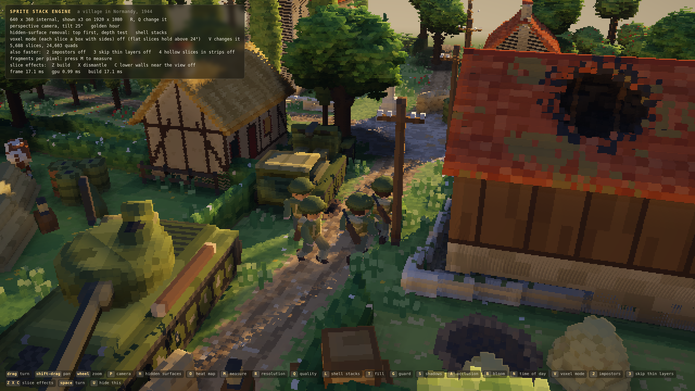
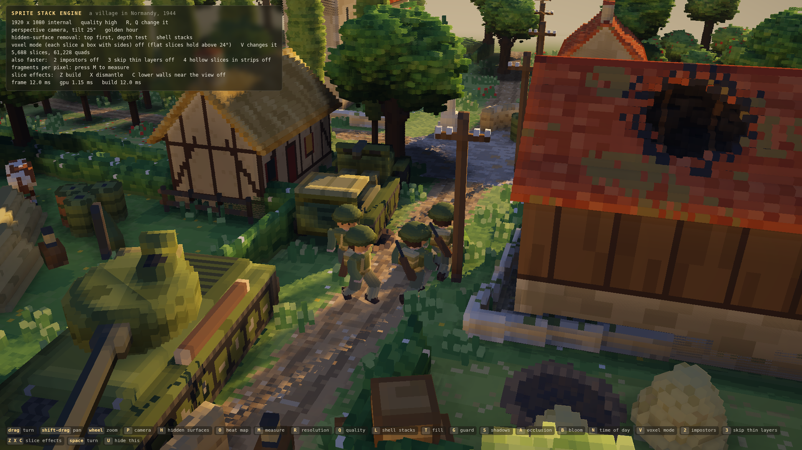
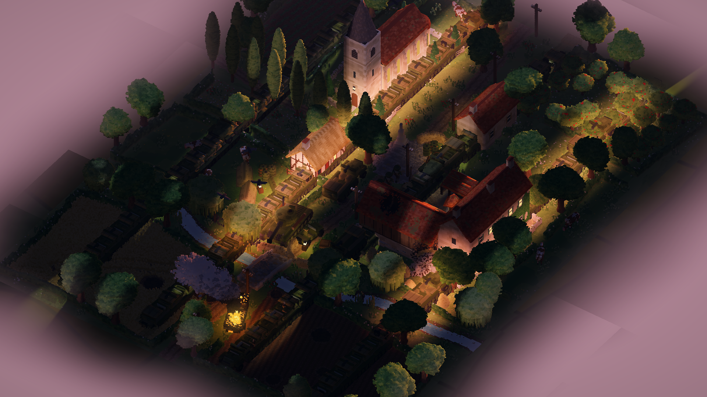
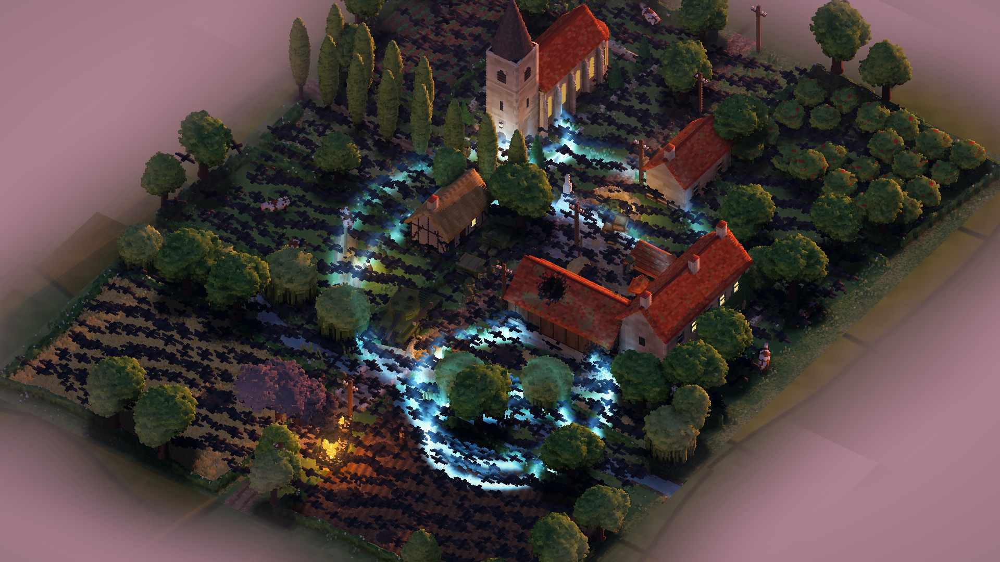
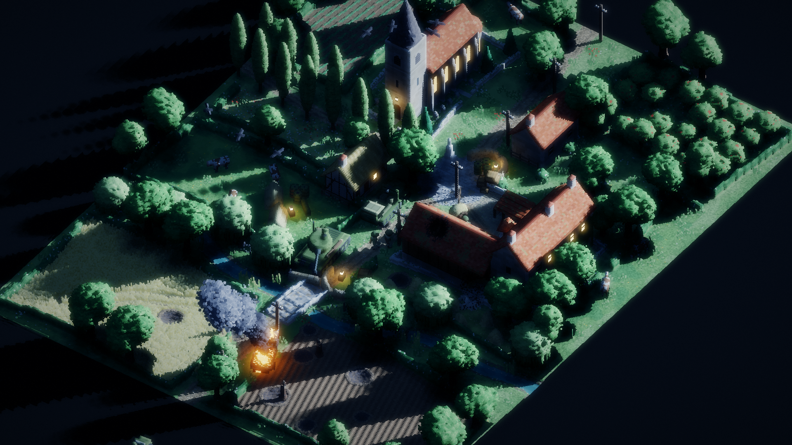
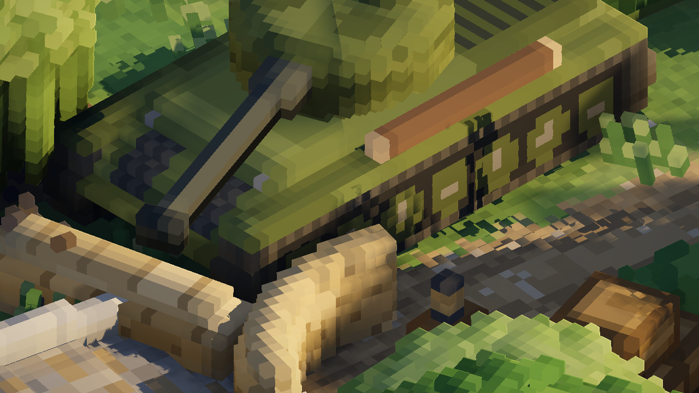
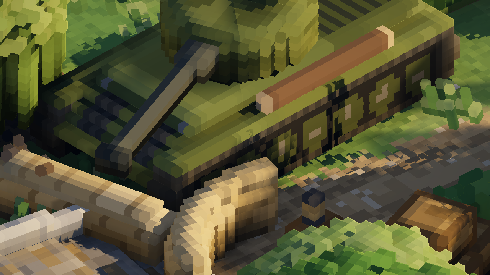
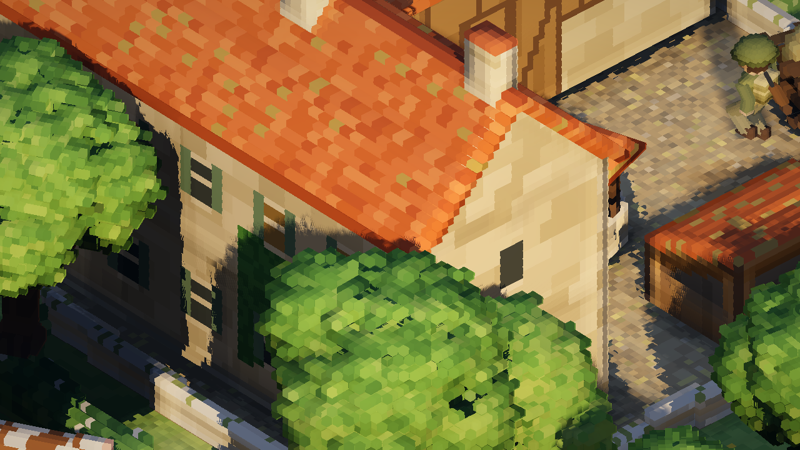
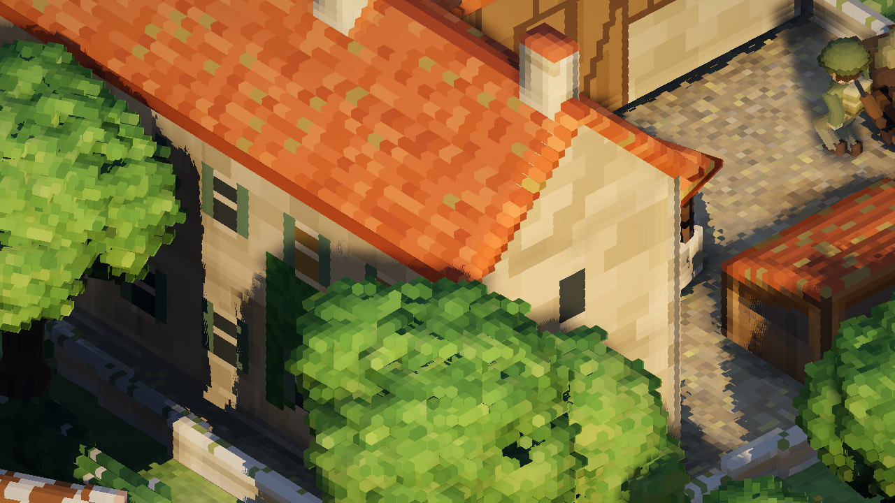

# Sprite stack engine


A small sprite-stacking renderer in plain WebGL2, with no libraries. Everything on screen is a stack of flat
slices, drawn as textured quads. The camera turns, tilts and zooms freely, in a parallel or a perspective
view, and the cost stays near one fragment written per pixel.

Designed and directed by @loktar00; the code was written by Claude (AI) under his direction.

**[Live demo](https://loktar00.github.io/sprite-stack-engine/)**

It exists to test two claims about sprite stacking with numbers instead of opinions:

- *"Slices break apart with a free camera."* They do if you draw one quad per slice. They do not if every
  slice is drawn once per screen row its layer covers. Press **T** to see both. That holds down to a measured
  tilt; below it the engine changes to [voxel mode](#voxel-mode), says so on screen, and stacks stay solid all
  the way to the horizon.
- *"Overdraw is around 99x at 1080p."* Drawn naively it is worse than that: this scene reaches **103 fragments
  per pixel** at street level. Drawn front to back with a depth test it is **1.09**. Press **O** for the heat
  map and **H** to switch.

And one more thing, which matters more than either: [it's about the look](#its-about-the-look), not about the
slices. The art is the constant and the renderer is a choice: there are faster ways to draw the same stacks
(**V**, **2**, **3**), and there are things only slices do (**Z**, **X**, **C**).

The demo scene is a village in hedgerow country in the summer of 1944, lit by a low sun that sinks to dusk.
The lighting is one pass over the screen and is written to be read: every effect has a comment in
`js/engine.js` and a line [below](#the-light-pass).

Open `index.html` in a browser with WebGL2. It runs from the file system; there is nothing to install or build.
It opens at a pixel-art 640x360 inside, scaled up; `?q=high` or **Q** gives the native-resolution look of the
stills here, and `?q=low` is for [weak GPUs](#resolution-and-weak-gpus).

| | |
| --- | --- |
| Drag | turn and tilt |
| Shift-drag, right-drag | pan |
| Wheel | zoom |
| V (or 1) | voxel mode (each slice drawn as a box with sides): by itself (the default), always, never |
| 2, 3 | more faster ways to draw: impostors, skip thin layers |
| Z, X, C | slice effects: build, dismantle, lower the walls near the view |
| P | parallel / perspective camera |
| H | hidden-surface removal / painter order |
| O | overdraw heat map: fragments written, fragments covered, off |
| M | measure fragments per pixel every frame |
| R | internal resolution: 360 (the default), 540, 720, native |
| Q | quality preset: low, med, high |
| L | shell stacks on / off |
| T | thickness fill on / off |
| G | edge-on guard on / off |
| 4 | hollow slices drawn as strips round their hole (off by default: see Weak GPUs) |
| S, A, B | shadows, ambient occlusion, bloom |
| N | time of day: drifting, afternoon, golden hour, dusk |
| Space | stop or start the slow turn |
| U | hide the read-out |

The page opens on the fast path (hidden-surface removal, shell stacks). **H** shows what it costs without.

## Resolution, and weak GPUs

The page opens at an internal 640x360 on a 1080p screen, shown three times larger with square pixels and no
smoothing. That is on purpose, twice over.

It is how pixel art is meant to be seen. The art here is authored at about one pixel per layer; drawing it at
1080p only turns each art pixel into a block of screen pixels and lights every one of them separately.

And it is what makes the page run on weak hardware. The cost of a frame goes with the number of pixels drawn,
and with flat slices it falls faster than that, because a layer a third as tall on screen needs a third of
the copies.





| | |
| --- | --- |
| `?res=360`, `540`, `720`, `native` (key **R**) | The internal height asked for. The engine takes the largest whole-number scale that does not go below it, so pixels stay square: 3 for 360 on a 1080p screen, 2 for 540; 720 does not divide 1080, so there it comes out native. Where the canvas does not divide evenly there is a thin bar at the edge. |
| `?q=low` (key **Q**) | 360, [voxel mode](#voxel-mode) on everywhere, no bloom, a shorter shadow walk (14 steps, not 48), 4 occlusion samples instead of 16, thin layers skipped. The fastest the page goes. |
| `?q=med` | 540, everything on, and voxel mode whenever the camera is in perspective (street level, where it cuts the fill most). |
| `?q=high` | Native, everything on: the look in the stills and the film on this page. |
| no `q` | 360, everything on, flat slices. |

The low and med presets use voxel mode because of one row in the tables on this page: at street level at
1080p, flat quads cover 137.8 fragments per pixel (668 at the worst pixel) and voxel mode covers 9.2 (38 at
the worst). Whenever voxel mode is drawing, the badge says so; nothing is switched quietly.

**The case that prompted this.** A reader ran the earlier version of this page, which opened at native
resolution, on an Intel UHD 630 at 1080p, street level, and reported 74.8 ms a frame (13 frames a second);
61.8 ms with shadows, occlusion and bloom off; and 7.15 ms (140 frames a second) at an internal 640x360.
Those are his numbers, not ours: we have no such machine. They say the frame is bound by fill, not by
lighting, and the fragment counts in this README say the same.

**A real integrated GPU.** Measured by the project's owner on a laptop: Intel Iris Xe (i7-1195G7), Edge 158,
ANGLE on D3D11, Balanced power plan, plugged in. Street view, 1920x1080 window, `demo.bench` over 120 frames,
this page as published.

| setting | internal | drawn as | quads or boxes | covered avg | ms/frame | frames a second |
| --- | --- | --- | ---: | ---: | ---: | ---: |
| the default | 640x360 | flat quads | 23946 | 49.1 | 4.4 | 227 |
| `?q=low` | 640x360 | voxel mode | 5394 | 9.2 | 3.7 | 270 |
| `?q=med` | 960x540 | voxel mode | 5394 | 9.2 | 5.6 | 179 |
| `?q=high` | 1920x1080 | flat quads | 59932 | 137.8 | 16.6 | 60 |
| high, shadows, occlusion and bloom off | 1920x1080 | flat quads | 59932 | 137.8 | 11.9 | 84 |
| high, voxel mode | 1920x1080 | voxel mode | 5394 | 9.2 | 13.7 | 73 |
| high, voxel mode, shadows, occlusion and bloom off | 1920x1080 | voxel mode | 5394 | 9.2 | 9.0 | 111 |

On this chip the light pass and the resolution are what count. At 1080p, switching the lighting off saves
about 4.7 ms with flat quads and with voxel mode alike, while voxel mode, which covers a fifteenth of the
fragments, saves about 3. Flat slices at native 1080p with everything on still hold 60 frames a second here,
and the default runs at 227. The reader's UHD 630 is an older and slower chip, and his numbers stand as his:
there the slice pass weighed far more (lighting off saved him 13 ms of 75). Two machines, two different
balances, and the same lever on both: draw fewer pixels.

**What we can measure.** The street view, at three internal resolutions, with the lighting of the high and
of the low preset, drawn three ways (`tools/bench.py --weak`, and again with `--software`). "GPU" is the RTX
5090 used throughout, 200 frames. "CPU stand-in" is SwiftShader, a software rasteriser, 3 frames a row on a
busy machine: it stands in for "fill is expensive", and it is **not** a UHD 630 number. Covered is per
internal pixel.

| internal | lighting | drawn as | quads or boxes | covered avg | GPU ms | CPU stand-in ms |
| --- | --- | --- | ---: | ---: | ---: | ---: |
| 1920x1080 | high | flat quads | 59932 | 137.8 | 2.55 | 1010 |
| 1920x1080 | high | flat quads, hollow slices in strips | 75102 | 80.7 | 2.94 | 977 |
| 1920x1080 | high | voxel mode | 6458 | 6.8 | 1.09 | 447 |
| 1920x1080 | low | flat quads | 59932 | 137.8 | 2.34 | 936 |
| 1920x1080 | low | flat quads, hollow slices in strips | 75102 | 80.7 | 2.80 | 883 |
| 1920x1080 | low | voxel mode | 6458 | 6.8 | 0.88 | 368 |
| 960x540 | high | flat quads | 33360 | 71.1 | 1.38 | 334 |
| 960x540 | high | flat quads, hollow slices in strips | 41234 | 42.1 | 1.63 | 348 |
| 960x540 | high | voxel mode | 6458 | 6.8 | 0.74 | 151 |
| 960x540 | low | flat quads | 33360 | 71.1 | 1.30 | 313 |
| 960x540 | low | flat quads, hollow slices in strips | 41234 | 42.1 | 1.60 | 316 |
| 960x540 | low | voxel mode | 6458 | 6.8 | 0.72 | 130 |
| 640x360 | high | flat quads | 23946 | 49.1 | 1.16 | 202 |
| 640x360 | high | flat quads, hollow slices in strips | 29323 | 29.4 | 1.26 | 226 |
| 640x360 | high | voxel mode | 6458 | 6.8 | 0.67 | 98 |
| 640x360 | low | flat quads | 23946 | 49.1 | 1.10 | 172 |
| 640x360 | low | flat quads, hollow slices in strips | 29323 | 29.4 | 1.30 | 201 |
| 640x360 | low | voxel mode | 6458 | 6.8 | 0.62 | 89 |

And the presets as the page applies them, same view, same two machines (a later and busier run, so compare
these four with one another):

| preset | internal | drawn as | quads or boxes | covered avg | GPU ms | CPU stand-in ms |
| --- | --- | --- | ---: | ---: | ---: | ---: |
| none (the default) | 640x360 | flat quads | 23946 | 49.1 | 1.72 | 244 |
| low | 640x360 | voxel mode | 5394 | 9.2 | 0.91 | 107 |
| med | 960x540 | voxel mode | 5394 | 9.2 | 0.95 | 197 |
| high | 1920x1080 | flat quads | 59932 | 137.8 | 4.01 | 1239 |

- **Resolution is the big lever.** From native to 360 the flat quads cover 49 fragments per internal pixel
  instead of 138, on a ninth of the pixels: about 25 times fewer fragments in all. The stand-in goes from
  1010 ms to 202.
- **Voxel mode is the second.** A box per slice covers 7 to 9 fragments per pixel whatever the resolution,
  and is 2 to 2.5 times faster than flat quads on the stand-in in every row. (The voxel rows here also use
  the strips described below, which is why they show 6.8 and not 9.) The low preset (360, voxel
  mode, cheap lighting) takes the stand-in from 1010 ms to 89, eleven times.
- **Lighting is the small one on these two machines**, as the reader found on his: the low preset's
  lighting saves about a tenth. (On the Iris Xe above it is the larger share. It depends on the chip.)

**Is it the `discard`?** Partly, and it cannot be fixed from inside flat slices. The slice shader throws
away empty texels, so the GPU cannot write depth before running it; whether it still *tests* depth early is
up to the driver. WebGL2 has no counter for fragment-shader runs (there are no pipeline statistics), so
"fragments shaded" cannot be measured in the page: all that can be said is that it lies between written
(1.09) and covered (138). We tried the clean fix that stays with flat slices: a shell slice of a house is a
thin frame round a large hole, so draw it as up to four strips round the hole instead of one rectangle (key
**4**, `?split=1`; the "hollow slices in strips" rows). Covered falls from 138 to 81 at 1080p and not one
pixel of the picture changes. It did not pay on either machine we have: there are a quarter more quads to
build and sort, and the frame went from 2.55 to 2.94 ms on the GPU and from 1010 to 977 ms on the stand-in.
It is off by default. On a GPU that is purely fill-bound it may pay; we could not test that. What does pay
is not drawing the copies at all, which is voxel mode.

**Send numbers.** If you have an integrated GPU, open the page, go to street level (**P**, zoom in), press
**M**, and note the frame time at the default, with `?q=low` and with `?res=native`; or run
`python tools/bench.py --weak`. An issue with the GPU's name and those numbers would be welcome, good or bad.

## Measured

Everything in this section is measured at native resolution (`?res=native`), which is the hard case, not at
the 360 the page opens with.

1920x1080 canvas, headless Chromium, one desktop GPU (NVIDIA RTX 5090, ANGLE on Vulkan). "Overview" is the
parallel camera over the whole map; "street" is the perspective camera low on the road by the tank, the worst
case here. Fragments are counted exactly by the count pass (see below), not estimated. Milliseconds are whole
frames: moving the scene, building and sorting the instances, the slice pass, the light pass, bloom and the
blit, each frame waited for, averaged over 200 frames.

| view | resolution | order | quads | written avg | written max | covered avg | covered max | ms/frame |
| --- | --- | --- | ---: | ---: | ---: | ---: | ---: | ---: |
| overview | native 1920x1080 | painter, whole stacks | 25182 | 12.92 | 127 | 22.2 | 286 | 1.04 |
| overview | native 1920x1080 | painter, shell stacks | 24881 | 8.84 | 125 | 20.9 | 284 | 1.01 |
| overview | native 1920x1080 | hidden-surface, whole stacks | 25182 | 0.67 | 2 | 22.2 | 286 | 0.95 |
| overview | native 1920x1080 | hidden-surface, shell stacks | 24881 | 0.67 | 2 | 20.9 | 284 | 0.93 |
| overview | internal 960x540 | painter, whole stacks | 16497 | 9.29 | 83 | 15.5 | 177 | 0.68 |
| overview | internal 960x540 | painter, shell stacks | 16196 | 6.16 | 78 | 14.3 | 175 | 0.69 |
| overview | internal 960x540 | hidden-surface, whole stacks | 16497 | 0.67 | 2 | 15.5 | 177 | 0.74 |
| overview | internal 960x540 | hidden-surface, shell stacks | 16196 | 0.67 | 2 | 14.3 | 175 | 0.73 |
| street | native 1920x1080 | painter, whole stacks | 60140 | 103.43 | 490 | 141.1 | 670 | 2.65 |
| street | native 1920x1080 | painter, shell stacks | 59932 | 50.79 | 474 | 137.8 | 668 | 2.30 |
| street | native 1920x1080 | hidden-surface, whole stacks | 60140 | 1.09 | 3 | 141.1 | 670 | 1.70 |
| street | native 1920x1080 | hidden-surface, shell stacks | 59932 | 1.09 | 3 | 137.8 | 668 | 1.78 |
| street | internal 960x540 | painter, whole stacks | 33568 | 54.02 | 256 | 73.6 | 339 | 1.34 |
| street | internal 960x540 | painter, shell stacks | 33360 | 26.58 | 241 | 71.1 | 337 | 1.33 |
| street | internal 960x540 | hidden-surface, whole stacks | 33568 | 0.98 | 3 | 73.6 | 339 | 1.33 |
| street | internal 960x540 | hidden-surface, shell stacks | 33360 | 0.98 | 3 | 71.1 | 337 | 1.21 |

- **written**: fragments that reached the G-buffer, per screen pixel (all pixels; in the overview a third of
  the screen is open ground beyond the map, which no stack covers, so its best case is 0.67 and not 1).
- **covered**: fragments the quads cover, with no alpha or depth test. This is the rasteriser's load.
- Internal 960x540 is measured per internal pixel; it has a quarter of the pixels to begin with.

What the numbers say, and what they do not:

- The naive figure is real. Painter order at street level writes 103 fragments per pixel on average and 490 at
  the worst pixel.
- Hidden-surface removal takes written fragments from 103 to 1.09 (a factor of 95). The scene looks the same.
- It does **not** reduce what the rasteriser covers: 141 fragments per pixel still reach the depth test. A
  rejected fragment is cheap but not free, and whether the GPU runs the fragment shader for it depends on its
  early depth test. That is why this table reports "written" and "covered" and never "shaded". (Voxel mode,
  below, is what brings covered down: from 138 to 9.)
- Shell stacks cut written fragments 1.5 to 2.0 times in painter order and change nothing once the depth test
  is on. (Much of this scene is trees and hedges, which are mostly surface to begin with.)
- Half resolution roughly halves the fragments per pixel at street level (103 to 54) as well as quartering the
  pixels, because each layer needs half as many copies.
- On this GPU every row is far under a 60 Hz frame (16.7 ms), so these timings mostly show that the scene is
  small for the hardware. The fragment counts are the hardware-independent part. Run `tools/bench.py` on your
  own machine; `--software` uses a CPU rasteriser, where fill cost is not hidden.
- A good part of each frame is not fill at all. Building and sorting 16,000 to 60,000 instances in JavaScript
  takes 0.3 to 1.5 ms, and the light pass costs the same whatever the draw order: every pixel walks up to 48
  shadow steps and takes 16 occlusion samples. That is why the overview rows sit within 0.2 ms of one another.
- These numbers are higher than the ones this page first reported (0.46 ms for the overview and 0.83 ms at
  street level, with hidden-surface removal and shell stacks). That was a town block of 1,476 slices under
  one flat light; this is a map of 8,800 slices with the light pass described below. The machine is shared,
  and timings move by a few tenths of a millisecond from run to run.

### Without a GPU

The same benchmark on a CPU rasteriser (SwiftShader, `tools/bench.py --software`), where fill is not hidden by
fast hardware. The fragment counts came out the same as on the GPU (to within 0.01), as they should. The timings are
rough: only 6 frames per row.

| view | resolution | order | written avg | ms/frame |
| --- | --- | --- | ---: | ---: |
| overview | native 1920x1080 | painter, whole stacks | 12.92 | 677 |
| overview | native 1920x1080 | painter, shell stacks | 8.84 | 688 |
| overview | native 1920x1080 | hidden-surface, whole stacks | 0.67 | 679 |
| overview | native 1920x1080 | hidden-surface, shell stacks | 0.67 | 673 |
| overview | internal 960x540 | painter, whole stacks | 9.29 | 272 |
| overview | internal 960x540 | painter, shell stacks | 6.16 | 281 |
| overview | internal 960x540 | hidden-surface, whole stacks | 0.67 | 286 |
| overview | internal 960x540 | hidden-surface, shell stacks | 0.67 | 268 |
| street | native 1920x1080 | painter, whole stacks | 103.42 | 1552 |
| street | native 1920x1080 | painter, shell stacks | 50.78 | 1492 |
| street | native 1920x1080 | hidden-surface, whole stacks | 1.09 | 1400 |
| street | native 1920x1080 | hidden-surface, shell stacks | 1.09 | 1383 |
| street | internal 960x540 | painter, whole stacks | 54.02 | 470 |
| street | internal 960x540 | painter, shell stacks | 26.58 | 456 |
| street | internal 960x540 | hidden-surface, whole stacks | 0.98 | 485 |
| street | internal 960x540 | hidden-surface, shell stacks | 0.98 | 1006 |

- On a CPU the light pass is now the main cost. The overview takes about 680 ms whatever the draw order,
  because the two million pixels each do the same shadow walk and occlusion samples; a quarter of the pixels
  takes it to about 275 ms. **S** and **A** switch shadows and occlusion off.
- At street level hidden-surface removal saves about a tenth at native resolution (1552 to 1400 ms). The
  rasteriser still walks every covered fragment, and covered fragments are what a CPU pays for.
- None of these rows is real time: a software rasteriser at 1080p is the wrong tool whatever the method.
- The machine was busy with other work during this run. One row (street, 960x540, hidden-surface, shell
  stacks, 1006 ms) is out of line with its three neighbours for that reason, so read these timings as orders
  of magnitude.

The two heat maps below are the street view at 1920x1080. (The frame times printed in these stills include the
count pass and its read-back, so they are not the timings in the table.)


## Voxel mode

Sprite stacking has a floor. A slice is a flat picture of one layer; seen from above it reads as a solid
because the layers overlap on screen. As the camera comes down towards the horizon each slice shrinks to a
line, the layers stop overlapping, and no amount of row fill puts back what is not there. This engine does not
pretend otherwise. Above a measured tilt it is pure sprite stacking: flat slices, nothing else. Below it, it
changes to **voxel mode**, shows a badge that says so, and stacks stay solid from any angle, level with the
ground included.


**What it is.** Each slice is drawn as what it stands for: a box one layer tall, with a top, four sides and a
bottom. The box is drawn once. Its fragment shader starts where the view ray enters the box and steps from
texel to texel of the slice until it meets a filled one, so every filled pixel of the slice becomes a small
column with its own side faces, or leaves the box. The point it finds writes its own depth, and the depth test
is always on, so boxes hide one another correctly whatever the camera does. The same slices, the same atlas,
the same light pass; only the slice pass changes (`VS_VOXEL` and `WALK` in `js/engine.js`, under a comment
block that says all this again).

**When it switches on.** By itself, in two cases (`needVoxel` in `js/main.js`):

- **The tilt is under the limit.** With the parallel camera that is 15 degrees. With the perspective camera
  it is 24 degrees: half the field of view (20) is where the highest ray on screen stops pointing down, which
  is also where height order stops being depth order, plus 4 to spare. Without voxel mode the camera is simply
  not allowed lower; with it the perspective camera goes down to 2 degrees.
- **A layer is taller on screen than the fill will cover.** Row fill draws at most 48 copies of a slice. Zoom
  in until one layer of something in view is more than 48 pixels tall and gaps open between the copies.

The limits are measured, not chosen by eye. `demo.holes()` draws a view both ways and counts the pixels where
flat slices show something more than a layer lower than voxel mode does, a gap seen through, as a share of
the pixels that show an object (`tools/bench.py --voxel`):

| tilt | parallel camera (village) | perspective camera (street) |
| ---: | ---: | ---: |
| 60 | 0.38% | 0.14% |
| 45 | 0.37% | 0.09% |
| 30 | 0.32% | 0.11% |
| 27 | 0.36% | 0.14% |
| 24 | 0.38% | 0.24% |
| 21 | 0.41% | 0.46% |
| 18 | 0.37% | 1.18% |
| 15 | 0.46% | 0.81% |
| 12 | 0.63% | 0.50% |
| 9 | 0.92% | 0.55% |
| 6 | 1.97% | 0.51% |
| 3 | 4.49% | 0.19% |

Down to 18 degrees the parallel camera sits on a floor of about 0.35 percent (things one pixel wide, where a
flat copy and a box cover different pixels). It lifts off at 15 and doubles by 9. The perspective camera
doubles between 27 and 21, on the way to the 20 degrees where its top rays turn level. Below that its count
is no longer a fair measure: slices then sort in the wrong order as well, which this count does not see, and
the picture is far worse than half a percent suggests (the first still above).


**The soldiers' limbs.** One part of this was a plain bug, found by looking at a soldier head-on. Arms and legs
are single slices strung along a bone. The engine treated every one-layer stack as flat and gave it no fill at
all, and the limb code spaced the slices up to 1.4 layers apart, so from the front a limb was a row of
separate discs at any tilt. Limb slices now get fill like everything else and are placed less than a layer
apart, and a soldier is solid head-on in plain sprite stacking.


**The badge.** "VOXEL MODE, slices get side faces", large, top centre, whenever it is on; it fades when the camera
tilts back up. The read-out says why it is on. **V** (or **1**) forces it on, forces it off, or hands the
choice back.
Forced off, the camera gets its old limits back.

**What it costs.**

| view | drawn as | quads or boxes | written avg | covered avg | gaps | ms/frame |
| --- | --- | ---: | ---: | ---: | ---: | ---: |
| overview, tilt 41 | flat slices | 24881 | 0.67 | 20.9 | 0.70% | 0.95 |
| overview, tilt 41 | voxel mode | 8543 | 0.67 | 7.7 | 0 | 0.68 |
| street, tilt 25 | flat slices | 59932 | 1.09 | 137.8 | 0.18% | 1.68 |
| street, tilt 25 | voxel mode | 5394 | 0.99 | 9.2 | 0 | 0.66 |
| level, tilt 8 | flat slices | 81830 | 5.11 | 167.0 | 0.63% | 2.09 |
| level, tilt 8 | voxel mode | 5500 | 1.52 | 7.2 | 0 | 0.65 |

("Gaps" is the count above. Flat slices at 8 degrees are there only for the comparison: the camera
does not go there without voxel mode.) On this GPU voxel mode is the cheaper of the two wherever both work:
one box of twelve triangles per slice instead of up to 48 quads, so a tenth of the instances to build and
sort and a fraction of the fragments to rasterise. What it gives up is the early depth test, because its
shader writes depth, and it runs a short loop per fragment (at most 48 steps), so on hardware where fragment
work is the limit the balance may differ; that is not measured here. It stays off above the limits anyway,
because the point of this page is what flat slices can and cannot do, and where exactly they stop.

## It's about the look

The point of sprite stacking is not the slices. It is the look: art authored as layers of pixels, and the
chunky, hand-made solidity that gives a scene. Drawing every slice as its own flat quad is only the simplest
renderer for that art, and it is the slow one. **The art is the constant; the renderer is a choice.** Three
other choices are here as switches. And what slices are uniquely good at is something else again: every slice
is its own thing, so an object can be built, taken apart or cut open one slice at a time.

### Faster ways to draw the same art

Each is a key, and each is measured alone and together against plain quads (`tools/bench.py --tricks`):
hidden-surface removal and shell stacks on throughout, 200 frames, same GPU as above. "Far" is the whole map
seen small, at a third of the resolution, which is where the last one has something to do.

| view | drawn as | quads or boxes | written avg | covered avg | covered max | ms/frame |
| --- | --- | ---: | ---: | ---: | ---: | ---: |
| overview, 1920x1080 | flat quads (none) | 24881 | 0.67 | 20.9 | 284 | 0.96 |
| overview, 1920x1080 | voxel mode (each slice a box with sides) | 8543 | 0.67 | 7.7 | 92 | 0.73 |
| overview, 1920x1080 | impostors | 9947 | 0.87 | 12.8 | 259 | 0.64 |
| overview, 1920x1080 | skip thin layers | 24881 | 0.67 | 20.9 | 284 | 0.92 |
| overview, 1920x1080 | voxel mode + impostors | 4174 | 0.88 | 5.7 | 84 | 0.52 |
| overview, 1920x1080 | all three | 4174 | 0.88 | 5.7 | 84 | 0.53 |
| street, 1920x1080 | flat quads (none) | 59932 | 1.09 | 137.8 | 668 | 1.70 |
| street, 1920x1080 | voxel mode (each slice a box with sides) | 5394 | 0.99 | 9.2 | 38 | 0.67 |
| street, 1920x1080 | impostors | 59932 | 1.09 | 137.8 | 668 | 1.75 |
| street, 1920x1080 | skip thin layers | 59932 | 1.09 | 137.8 | 668 | 1.71 |
| street, 1920x1080 | voxel mode + impostors | 5394 | 0.99 | 9.2 | 38 | 0.65 |
| street, 1920x1080 | all three | 5394 | 0.99 | 9.2 | 38 | 0.87 |
| far (whole map small), internal 640x360 | flat quads (none) | 8887 | 0.12 | 1.5 | 93 | 0.67 |
| far (whole map small), internal 640x360 | voxel mode (each slice a box with sides) | 8623 | 0.12 | 1.4 | 91 | 0.70 |
| far (whole map small), internal 640x360 | impostors | 4221 | 0.16 | 1.0 | 89 | 0.51 |
| far (whole map small), internal 640x360 | skip thin layers | 5046 | 0.11 | 0.7 | 49 | 0.54 |
| far (whole map small), internal 640x360 | voxel mode + impostors | 4202 | 0.16 | 1.0 | 83 | 0.51 |
| far (whole map small), internal 640x360 | all three | 3005 | 0.14 | 0.7 | 48 | 0.52 |

- **V, voxel mode (each slice drawn as a box with sides).** This is the [voxel mode](#voxel-mode) above,
  forced on at any tilt (it is one renderer, with one key), and it is the biggest win by a long way: at street level 59,932 quads become
  5,394 boxes, the fragments the rasteriser covers go from 138 per pixel to 9, and the frame from 1.7 ms to
  0.7. It should be said plainly what it is: **a voxel-style renderer for the same stack-authored art.** Not
  one slice was redrawn for it. Layers that repeat the one under them also merge into one taller box (a
  "run", up to three layers), but that finds little here: 45 of 2,592 layers repeat, because walls and leaves
  are painted pixel by pixel. The costs are the ones listed under voxel mode.
- **2, impostors** (`VS_IMP`, `prepareImpostors`). A stack that never changes and stands in many places (549
  trees, tufts, graves and poles here) is drawn ahead of time from 32 directions into an atlas that keeps
  what the G-buffer needs: material, facing and height. After that it is one quad, lit and shadowed like
  everything else, and it still leans in the wind. The catches are real: the stack turns in steps of 11
  degrees as the camera goes round; the sprites hold for one tilt of the parallel camera only (they are drawn
  again, about four times a second at most, while the tilt changes, and the perspective camera does not use
  them at all, which is why the street rows do not move); they are sharp at one zoom (3 pixels per unit) and
  resampled at others; and the atlas is 4096 by 2048 twice over, 64 MB.
- **3, skip thin layers.** When a layer is thinner than a pixel on screen, several layers land on the same
  row; one of them is kept and the rest are left out. At 1080p nothing in this scene is that small, so the
  overview and street rows do not move. Seen far off at low resolution it nearly halves the quads.

Is the picture the same? Nearly, and not exactly. Against plain quads, counting pixels that differ by more
than a tenth of full scale: voxel mode changes 2 to 4 percent of the screen, almost all of it along
silhouettes and in the dither of shadow edges (which follows the exact height of each pixel); impostors
change 3 percent of the overview, at the outlines of trees; skipping thin layers changes nothing at 1080p and
2 percent of the far view. None of it reads as a different picture. The two heat maps show what the
rasteriser covers at street level, with flat quads and in voxel mode.


### What only slices do

Each of these is a small function that the engine calls once per slice of one stack (`each` on a list item;
the three are in `js/main.js` under "slice effects"). It moves the slice, or leaves it out. The height map
follows, so shadows and occlusion change with the object. They work in either way of drawing.

**Build (Z).** Slices drop in from above, the lowest first, each turning a little as it settles: a cottage
goes up, sandbags are laid, tents are pitched.


**Dismantle (X).** Slices fly off the top one after another, spin, shrink and are gone: a shell takes the
roof off the barn. (They come back the same way.)


**Lower the walls (C).** Every slice above a height is left out, and the height slides down: the walls of a
building near the point the camera looks at sink to waist height, and the room and the men in it show. The
farmhouse and the church have rooms. It is off until asked for.


The honest limits: a slice that flies is still flat, so a dismantled roof is a spray of flat plates, not
rubble; shell stacks are hollow, which shows as frames while a building goes up; and nothing here fades,
because the G-buffer holds one opaque surface per pixel (slices shrink instead).

## The techniques

**Slices as instanced quads** (`js/engine.js`, `build` and `VS_SLICE`). Each slice copy is one instance:
position, rotation, atlas rectangle, offset from the stack's axis, scale. The whole scene is one
`drawArraysInstanced` call per pass. Stacks outside the view are left out before that (a sphere round each
stack against the edges of the view).

**Thickness fill.** A layer is a slab but a slice is a plane, so a tilted camera sees between them. Each slice
is drawn once for every screen row its layer is tall, `ceil(pixels per unit * cos(pitch))` copies at heights
`z + k / copies`. In perspective the count is worked out per stack from its distance. A layer with no exposed
side (flat ground inside a ground tile) has nothing to fill and is drawn once.


**Edge-on guard.** Near the horizon a slice has almost no height on screen and can fall between two pixel rows.
The vertex shader pushes every corner half a pixel away from the slice's centre line, so a slice always covers
at least one row.

**Height order is depth order.** With the camera above the scene, the higher of two points on one view ray is
always the nearer one. Sorting by height is therefore an exact depth sort for the parallel and for the
perspective camera, as long as every ray points downward (`pitch > fov / 2`; the demo clamps the tilt). The sort
is a counting sort into height buckets, redone every frame.

**Painter order.** Lowest bucket first, no depth test. Every slice is drawn in full. This is the classic
method and the source of the overdraw.

**Hidden-surface removal.** The same instances, highest bucket first, with the depth test and depth writes on.
The first slice to reach a pixel is the visible one and everything under it is rejected. It is the idea behind
drawing opaque geometry front to back on any z-buffered hardware.

**Shell stacks** (`js/art.js`). A slice pixel deep inside a solid is always hidden by the layer above. When the
atlas is built, pixels more than three from empty space are left out, so their fragments are discarded instead
of written. Slices are also cropped to their filled rectangle and empty layers dropped.

**Normals from the stack itself** (`js/art.js`). Each surface pixel faces the empty space within two pixels of
it, nearer space counting more. Two pixels instead of one rounds corners a little and turns the steps of a
roof into a slope. A stack can also tilt its normals with a function (furrows, cobbles, ruts: detail that costs
nothing to draw) or pull them towards "up" (wheat, grass, smoke, which would sparkle otherwise).

**Deferred lighting.** The slice pass writes no colour. It writes a small G-buffer: palette index, the facing
of that surface pixel, and height. The light pass then runs once per screen pixel: it looks up the colour and
rebuilds the world position by intersecting the pixel's view ray with the plane at the stored height.
Lighting cost does not grow with overdraw.

**Internal resolution.** The slice and light passes run at a whole fraction of the canvas size (a third on a 1080p screen by default) and are
scaled up without smoothing, each internal pixel a clean square. Native is kept to about two and a half
million pixels, so a 4K screen is drawn at half size.

**The count pass.** The same instances are drawn again into a 16-bit float target with additive blending,
adding 1 per fragment: once with the same tests as the real pass (written) and once with none (covered). The
texture is read back for the average and maximum, and shown through a colour ramp as the heat map.

## The light pass

One fragment shader, `FS_LIGHT` in `js/engine.js`, run once per screen pixel. It has the pixel's colour,
facing and height, and one small texture of the whole map: the height of the tallest solid thing over every
ground cell. Everything below comes from those.


| Effect | How |
| --- | --- |
| Key light | A warm sun, low in the sky: `colour * max(dot(normal, sun), 0)`. |
| Sky and earth fill | No flat ambient. What faces up takes cool light from the sky, what faces down takes warm light off the earth, blended by the normal's `z` (hemisphere lighting). |
| Bounce | A stand-in for light reflected off sunlit ground: warm, level, strongest on walls turned away from the sun, so a wall in shade keeps its form. |
| Ambient occlusion | Eight directions round the pixel at two distances in the height map; land that rises above the pixel takes away sky. Walls are sampled out in front of themselves. |
| Contact darkening | Walls darken towards their foot, by their height over the ground in front of them. |
| Soft shadows | A walk towards the sun over the height map, in 48 steps that grow from 1.3 to 4.6 units. The smallest clearance over the land, divided by the distance walked, is the light that gets through: sharp at the foot of a wall, soft at the tip of the shadow. |
| Shadow dither | Each art pixel takes steps of a slightly different length, which turns the banding of a coarse walk into a fine dither that stays put on the ground. |
| Shadows of moving things | Soldiers, the jeep, smoke and birds are not in the height map. Each is a cylinder or a blob, and the ray to the sun is tested against its axis. |
| Cloud shadows | Two layers of slow noise that slide over the land and dim the sun. |
| Rim light | Where the next pixel towards the sun on screen is much lower, this pixel is a sunward edge and catches extra light. |
| Lamps | Point lights that fall off to nothing at their reach: lanterns at dusk, and the fire. Up to 256, with cone lights beside them: see Lights and hordes. |
| Pixels that shine | A glow value per material in the palette. Fire always shines; lamps and windows are dull by day and light as dusk falls. |
| Bloom | What shines is copied at a quarter of the size, blurred across and down twice, and added back over the sharp picture. |
| Water | Ripples in the normal that drift, a share of the sky's colour, and a glint of the sun. |
| Haze | Things further into the picture take on the colour of the air. |
| The edge of the map | Dissolves into the haze. Beyond it the shader makes up a patchwork of fields from noise, so the map does not end at a ruled line. |
| Tone curve | Leaves dark and middle tones alone and rolls bright ones off towards white instead of clipping them. |
| Grade | A little more saturation, warmer highlights, cooler shadows, and darker corners. |
| Day to dusk | One number, the time of day, moves the sun down and round, reddens and dims it, turns the sky's fill from blue to violet, thickens the haze and lights the lamps (`Scene.light` in `js/scene.js`). |

**S**, **A** and **B** switch shadows, occlusion and bloom off, to see what each one adds.

## Lights and hordes



For games with many lights and many moving things: a swarm, a convoy, a night defence. All of it is off unless
asked for, and the village looks and runs as before. In the demo, **?horde=9&lights=18&cones=9&lightmap=1&tod=1**
sends a convoy down the road at dusk: headlamps (cone lights), lamps and tail lights (point lights), and the
street lamps on the road's poles from a light map. `?bots=400&rows=1` puts flocks of birds over the fields,
from typed arrays, with a flash running through them (a palette row). The thousands-strong cases in the tables
below are behind `?stress=1`; they are for measuring and are not meant to be looked at.

**Point lights.** `opt.lamps` takes up to 256: `[x, y, z, reach, r, g, b, occlude, halo]`. The first seven
are as before; the last two are optional.

- `occlude` (1 or 0): the light is shadowed by the height map (seven steps from the pixel to the light). It
  costs, so keep it for the few lights that matter: the ones nearest the player.
- `halo`: how strongly the light glows in the air round itself, where the view ray passes closest to it.

`opt.lampCap` (0, the default, turns it off) rolls off the sum of all lights on a pixel, so fifty muzzle
flashes in one spot light the ground without bleaching it to white. 0.3 to 0.6 suits a crowd of lights.

The lights go to the shader in a small float texture, a column per light, so their number costs no uniforms;
the shader stops at the count given. Each light costs every pixel a few instructions (a distance test), and
the ones in reach a little more, so 256 lights at full resolution is affordable on a desktop GPU and worth
thinning out on a weak one (see the numbers below).

**Cone lights.** `opt.cones` takes up to 16: `[x, y, z, range, dx, dy, dz, half angle, r, g, b, beam]`. The
axis need not be unit length; the half angle is in radians. Each lights a pool where it lands, with a soft
edge and a brighter core, and if `beam` is above 0 it shows as a shaft in the air, marched in 12 steps along
the part of each view ray inside the cone.

`opt.coneBlockers`: `[[x, y, radius, height]]`, the posts, trunks and walls that should cut the cones. The
engine builds a shadow table per cone from them each frame (64 angles round the light, the nearest blocker
and its height), and the pool and the beam both read it, so a tree cuts a dark wedge out of a searchlight.
Without blockers the cones are not shadowed.

**Fade.** Any item can carry `fade` (0 to 1): that share of its pixels is left out, in a fixed 4 by 4 dither.
What is behind shows through without sorting or blending: a tree between the camera and the player, a wreck
sinking out of sight, a horde fading in at the edge of the map. It works in flat-slice and voxel mode.

**Taller layers.** `zs` on an item draws each layer `zs` times as tall (trees of one model at different
heights). A model can also be sampled finer than the scene's art pixel: `res` (and `zres` for the height) in
its definition draws it that much smaller, so a detailed close-up model fits in. Slice effects (`each`) see
the layer heights already scaled; an item with an effect may set `reach`, how far the effect moves slices,
for culling.

**Hordes.** A game that keeps its units in typed arrays hands them to the engine as they are, with no object
per unit: `opt.horde` is a list of groups.

```js
const bots = { frames: walkFrames,          // one stack per frame of the walk
  n: count, x: xs, y: ys, z: null, rot: headings,   // Float32Array (z null: on the ground)
  frame: frameOf,                           // Uint8Array, an index into frames
  row: rowOf,                               // Uint8Array or null: the palette row (see below)
  fade: null,                               // Uint8Array or null: 0..255
  scale: 1 };
E.render({ ..., list: list, horde: [bots] });
```

The engine walks the arrays inside its own build loop: each unit is culled and written to the instance buffer
like an item, with nothing allocated. 6000 three-layer birds (the `--hordes` bench) cost the engine 0.39 ms
more a frame on the machine of the table below, about 0.065 ms per thousand; the same through item
objects costs about the same, so the typed path is mainly about the game not having to keep objects at all.

`Engine.itemPool()` is the other way, for games that do want objects: it hands out the same items every frame,
so thousands of moving stacks make no garbage for the collector:

```js
const pool = Engine.itemPool();
function frame() {
  list.length = 0;
  pool.begin(list);
  for (let i = 0; i < count; i++) {
    const it = pool.add(walkFrames[(phase[i] * 6 | 0) % 6], x[i], y[i], 0, heading[i], 1);
    it.fade = fadeIn[i];                     // every optional field is reset by add
  }
  E.render({ ..., list: list });
}
```

**One shape for every item.** V8 (Chrome's JavaScript engine) gives every object a hidden class from its fields.
An object that gains a field after it is made, or an integer field that later takes a fraction, changes class
mid-run, and every optimised function that reads it is thrown away and rebuilt: a frame that stalls. The engine
makes its own objects whole and with fractions from the start (the stats, the slice-effect scratch, the horde's
scratch item, the item pool's items, the figure writer's items), and `Engine.item(stack, x, y, z, rot, scale)`
makes an item the same way for a game. Measured on the demo, 1600 frames per case, before and after: the worst
frame fell from 27.1 to 10.3 ms with 2000 vehicles, 20.8 to 15.0 with 6000 birds, 10.0 to 4.6 with the convoy
and 18.0 to 9.2 at night; the 99th percentile fell by 10 to 33 % and the means by 3 to 8 %.

**Palette rows.** `E.setPalette(bytes, rows)` takes up to 64 rows of 256 colours (`bytes` is 256 x rows x 4).
An item's `row`, or a horde's `row` array, picks the row it is drawn in: a hit flash, a unit powered down, a
building under construction, all from the same stack in the atlas. The row rides in the instance (in the
fraction of its atlas line), and while the palette has more than one row the slice pass writes it to a third,
one-byte target that the light pass reads. With one row nothing changes and nothing extra is drawn. In the
demo, `?bots=400&rows=1` sends a white flash out through each flock every few seconds.

Animation is a choice of stack: build one stack per frame of a walk or a flap, and pick the frame from each
thing's phase. A moving horde then costs no more than a standing one. What it does cost is the slices: every
layer of every stack on screen is one quad (or one box in voxel mode), so the numbers below grow with the
models' height in layers. Keep horde models short, and draw the far ones with a smaller model or as
impostors.

**The fx hook.** `opt.fx(gl, M, size)` is called after the light pass with the lit picture bound and the
slice pass's depth buffer attached (it holds depths where the slices were drawn with the depth test: hidden-
surface removal or voxel mode). Draw sparks, tracers or smoke there with your own program (`E.program(vs,
fs)` compiles one) and `M.vp`; they are hidden behind what stands in front of them. The picture is tone-mapped
colour, and its alpha is how much each pixel blooms, so a particle that writes alpha glows. The engine puts its
own state back afterwards.

**World units.** The light pass was written with one world unit to an art pixel: the shadow walk's steps, the
occlusion radii, the rim, the edge of the map, the camera's near plane. `opt.unit` (1 if not given) is the size
of an art pixel in world units, and all of those scale with it, so a game in metres (`unit: 0.1`, items at
`scale: 0.1`) lights like the village. In the demo, `?unit=0.1` draws the village with every length times 0.1:
it looks the same (a pixel here and there differs by rounding). `Engine.cameraMatrices(cam, aspect, unit)`
takes the same unit.

**The height map's own box.** `E.setHeightMap(bytes, w, h, box, step)`: `box` is where it lies,
`[x0, y0, width, depth]` (a cell per unit at the origin if not given), and `step` the world height of one step
of a byte (0.5 if not given). A map of the same size as the last goes up in place, so a game can splat its
horde into a coarse height map every frame and have thousands of units throw shadows for one upload.

**The ground map.** `E.setGroundMap(bytes, w, h, box)`: open ground (wherever no slice was drawn) inside `box`
takes its colour from this, one RGBA texel per cell: palette index A, palette index B, and how far A has worn
towards B (0 to 255). A flat world then costs no instances at all, and tracks, scorch marks and craters are
texel writes: `E.patchGroundMap(bytes, x, y, w, h)`. `setGroundMap(null)` switches it off. `?groundmap=1` in
the demo paints the country round the map with it, in the village's colours: the road carried on past the edges
as worn ruts, fields, and a few old shell scorches (the map itself is drawn by its tiles).

**The light map.** `E.setLightMap(bytes, w, h, box, scale)`: light that does not move (lamp masts, lit windows,
a glowing pool) painted into a world-space RGB texture and added to every pixel over it, read smoothed, 255
worth `scale`. Any number of static lights for one texture read; `E.patchLightMap` changes part of it, and
`opt.lightMapScale` sets its strength for a frame (the demo turns its street lamps up as dusk falls).
`?lightmap=1&tod=1` in the demo: warm pools under the poles along the road.

**Ring lights.** `opt.rings` takes up to 8: `[x, y, z, radius, width, r, g, b, glow, lift]`, a band of light
round a centre, for a pulse that grows outward. Whatever stands in the band and near its height is lit, faces
turned towards the band most; `glow` makes the band shine by itself, so it reads on black ground; `lift` raises
items with `lift: true` and horde groups with `lift: true` as the band passes under them (a bump that rides the
band). Compiled in only while there are rings. Lifting 6000 units under 8 rings costs about 0.15 ms of engine
CPU. `?rings=6&bots=400&tod=1` in the demo.



**A hard sun, and haze by height.** `light.soft` sets the sun's shadow softness directly (near 0: the hard
edge of a sun with no air; by default it follows the sun's height). `light.hazeH = [density, falloff]` adds
haze that is thick at the ground and thins upward, integrated along each view ray; `hazeK: 0` turns the
distance haze off.

**HDR.** `opt.hdr`: the light pass writes linear light to a half-float picture (where the GPU can render to
one), the fx hook can add light above 1, bloom takes what glows and what is brighter than `light.knee` (1 if
not given), and the tone curve and grade run after the bloom. What bloom and the post pass read is scrubbed
first (clamped, any NaN or infinity made 0), so one bad pixel cannot spread through the blur. By day it looks
like the default; at night bright lights and beams bloom. `?hdr=1` in the demo.

Cone lights, palette rows, the ground map, the light map and HDR are each compiled into their own build of
the shaders, made the first time they are used; the default build only gained the multiplications by the unit
and the height-haze test. The village draws the same, pixel for pixel, and its frame times are within noise.
Making a build takes time (compiling, linking and the driver's own work on its first draw), and if that happens
on the first frame that needs it, the game hitches. `E.warm({ cones, rings, rows, groundMap, lightMap, hdr })`
makes the ones a game says it will use at start-up: every combination of cones and rings (which come and go
from frame to frame) with the rest on. On the desktop of the tables here, the first frame with cones and rings
went from 6 to 13 ms to under 1 ms; a game reported 140 to 190 ms before warming. The demo warms what its
address asks for (`?nowarm=1` to see the difference).

### Night, and the film look



Two more opt-in pieces, for a look made of darkness, haze and the lights people carry. With neither set, nothing
changes. Fed the parameters of the night game they came from, they reproduce its frames: side by side over
seven moments of its play, the mean difference is under 1 of 765 per pixel at most moments (2 at the busiest),
and fewer than 0.3 % of pixels differ by more than 30.

**The night model.** `light.model: 'night'` swaps the light pass for one built for night:

| Piece | Parameters (in `light`, unless noted) |
| --- | --- |
| A low moon as the key, its shadows walked over the height map with a wide penumbra | `moon` (direction), `moonCol` |
| A dim hemisphere fill, occlusion, and a canopy (land overhead takes sky away) | `skyCol`, `earthCol` |
| Height fog: thick at the ground, thinning upward, integrated along each ray, clear near the eye, lit a little towards the moon | `fog: [density, thinning, moon in the haze]`, `fogCol`, `fogNear` |
| A screen-space rim: silhouette edges catch the moon and the warm lights round them | `rim`, `rimWarm` |
| Contact shadows under figures the height map does not hold (up to 8) | `opt.contacts: [[x, y, radius, strength]]` |
| Lamps with a windowed falloff, steep near the source, and a halo that follows the haze | `opt.falloff` (`'window'` by default here; `'linear'` for the day model's), `opt.lampCap` |
| Palette glow as light, only partly dimmed by the haze | `emissive` |
| The floor, where no slice was drawn | `floor` (a game's own GLSL: `vec3 floorAt(vec2 p, out vec3 n, out float wet, out float glow)`, with `hash`, `vnoise`, `u_time`, `u_floor[8]` (from `floorParams`) and `groundTexel(p)` (the ground map's raw texel) to hand, and `floorUniforms(gl, uniforms)` to set its own; it is built as its own shader, keyed by its source, and `E.warm({ night: true, floor })` builds it ahead), else the ground map, else `floorCol` |

Cones, rings, the light map, the ground map and palette rows work in it as in the day model. Its distances
are those of a scene whose art pixel is a tenth of a metre, scaled by `opt.unit`. It writes linear light (it
turns the half-float picture on) with the view distance in alpha, which the film post reads.

**The film post.** `opt.post: { bloom, vignette, grain, exposure, knee, grade: [contrast, black, saturation,
shadow blue], dof: [focus distance, its depth, screen row of the tilt-shift band (below 0: none), strength] }`:
bloom keyed on brightness above `knee`, a tilt-shift depth of field (crisp at the focus, soft nearer, further,
and towards the top and bottom of the frame, every internal pixel still square), an ACES-fitted tone curve, the
grade, a vignette and grain. It runs on the half-float picture; with the day model the light pass then writes
the view distance in alpha too. The night model always uses it.

**Two layers in the height map.** `E.setHeightMap(bytes, w, h, box, step, 2)`: two bytes a cell, the top of the
tallest thing and the bottom of its highest solid run, so a crown floats on its trunk and the sun or the moon
gets in under it (both models).

**Tall thin casters at night.** The moon's shadow walk starts each screen pixel at its own fraction of a step
(interleaved gradient noise), so the steps' banding becomes a fine noise that the grain hides; no step is longer
than a cell of the height map for the first few metres, so a trunk near the pixel is not stepped over; and with a
two-layer map, the clearance is worked out at the four cells round each point and then mixed, for the first 8
metres of the walk (a crown's bottom smoothed into an empty neighbour made a false floor that a walk under the crown
met cell by cell: zebra bands round every trunk). Real tree columns then throw clean shadows, with the moon under
the crowns, for 2 to 7 % more frame time in a dense forest. `light.walk: 'classic'` keeps the walk as it was.

**The camera's planes.** `cam.near` and `cam.far` set the near and far planes when the defaults (from
`opt.unit`) do not suit; a coneTable (`opt.coneTable`) gives the cones' shadow tables directly instead of
blockers. `Engine.create(canvas, { warm })` warms the builds a game will use at once (by default the plain and
the cone light passes); `E.warm` takes `night`, `floor`, `twoLayer` and `post` too. `?night=1` in the demo.

### Quality above the default

`opt.quality` (all optional) turns the picture up past the engine's usual look, for desktop GPUs; a game maps
its own presets onto it. With none of it set, nothing changes.

| Knob | What it does |
| --- | --- |
| `ss: 1.5` or `2` | Supersampling: the picture is drawn at 1.5 or 2 times the canvas and filtered down (four smoothed taps a canvas pixel, exactly a 2 x 2 box at 2); `opt.scale` is then ignored |
| `shadow: 2` | A finer shadow walk, for the sun and the moon: twice the steps, each half as long, the same reach |
| `shadowReach: 1.5` | Shadows that go further (more steps, same length) |
| `shadowSoft: 1.3` | A wider penumbra |
| `aoDirs: 16`, `aoRadius: 1.4` | Occlusion: more directions (8 by day, 6 at night, up to 16), looking further |
| `occSteps: 16` | Lamps that are occluded test more points between the light and the pixel (8, up to 32) |
| `beamSteps: 32` | Cone beams marched in more steps (12, up to 64): smoother shafts |
| `fxRes: 2` | Bloom and the depth of field at half the picture's size instead of a quarter, with an extra blur pass: smoother glow and bokeh at high resolution |

Contact shadows (night) now go up to 32. The height fog is integrated exactly, so it has no steps to raise.

What each costs, alone, at night on the street view with the convoy's lamps and headlamps (`?night=1&horde=9&lights=18&cones=9`),
on an RTX 5090, milliseconds a frame:

| Knob | 1920 x 1080 canvas | 2560 x 1440 canvas |
| --- | ---: | ---: |
| (none) | 2.06 | 3.08 |
| ss 1.5 | 3.52 | 5.69 |
| ss 2 | 5.12 | 8.50 |
| shadow 2 | 2.32 | 3.41 |
| shadowReach 1.5 | 2.08 | 3.71 |
| aoDirs 16 | 2.11 | 3.73 |
| aoRadius 1.5 | 2.09 | 3.59 |
| occSteps 16 | 2.14 | 4.10 |
| beamSteps 32 | 2.50 | 4.16 |
| fxRes 2 | 2.24 | 3.36 |
| all of them | 6.91 | 11.51 |

By day on the street (no lamps or cones), all of them together cost 4.95 ms at 1080p and 6.73 ms at 1440p,
against 1.83 and 2.58. Supersampling is most of it: it is paid per pixel, so twice the canvas is four times
the light pass. In the demo: `?ss=2`, `?shadowq=2`, `?reach=1.5`, `?soft=1.3`, `?aodirs=16`, `?aor=1.4`,
`?occq=16`, `?beamq=32`, `?fxres=2`, or `?ultra=1` for all of them (add `&fullres=1` on a large screen, so the
demo does not cap the resolution). Any canvas size works, 1440p and 4K included; the demo keeps native under
about 2.6 million pixels unless told otherwise, the engine itself does not.

### Self-shading

The light pass shades a model by its facing and by walks over the height map, so a model's own small shapes (a
turret over its hull, a barrel, eaves over a wall, a leg under a body) barely shade it. Baked self-shading adds
that, from the model's own voxels, once, when its stack is built:

- **occlusion**: how much of the space round each voxel is solid, at two radii: recesses, undersides and joints darken;
- **shadow**: for 8 directions round the model at one elevation, whether the model's own voxels stand between
  the voxel and the light (nearer blockers darker). The engine reads the two directions either side of the
  real key light (the sun, or the moon at night), turned with the model, and mixes them.

`new Art.Atlas(size, { self: true, elevation })` bakes both for every stack built into it (not ground tiles, or a
model with `noSelf`) into two more textures laid out like the atlas; give them to the engine with
`opt.self = { atlas: [E.makeAtlas(atlas.self0, size), E.makeAtlas(atlas.self1, size)], occlusion, shadow }`
(strengths, 1 if not given). It works for flat slices, voxel mode, impostors, horde frames and both light
models; the shaders that read it are their own builds (`E.warm({ self: true, ... })`).

Cost: the bake added about 0.3 s to the demo's load (every model, twice: whole and shell). At run time it is one
more texture write in the slice pass and one read in the light pass: on the default views 1 to 5 % (most of
that noise), more at 1440p night, where the third G-buffer target costs most. `?selfshade=1` in the demo.

| | Without | With |
| --- | --- | --- |
| A tank's turret and barrel over its hull |  |  |

**Live: the occupancy march.** The baked shading cannot see other models, and the height map cannot hold an
overhang. `Art.Occupancy(box, cell)` builds a coarse 3D grid of the scene from its stacks (each cell how full it is,
from 2 x 2 x 2 samples of the models' voxels); `upload(E)` gives it to the engine, `stamp(x, y, z, rx, ry, h)` puts
a moving thing in as a box and `flush(E)` sends just the blocks that changed (and puts back last frame's). With
`opt.occ = { steps, strength }` the light pass marches it from each pixel towards the sun or the moon, smoothed,
each pixel from its own fraction of a step, and the shadow it finds is combined with the height map's. Overhangs,
a barrel over its hull, a tree's shadow on a wall beside it, the soldiers' shadows: true self- and cross-shadows.

Cost: building the village's grid at 2-unit cells (256 x 192 x 64) takes 75 ms (517 ms at 1-unit cells, 25 MB).
At run time, on a busy desktop (so take the numbers loosely), about +0.4 ms at 1920 x 1080 in the overview and
+0.7 ms in the street, more at 1440p, and a fixed part on the CPU for the moving things' blocks. It is meant for
the High and Ultra presets. `?occ=1` in the demo (`&occsteps=64`, `&occcell=1`).

| | Without | With |
| --- | --- | --- |
| A tree's shadow on the farmhouse wall |  |  |

**The final hook.** `opt.final(gl, ctx)` runs after the light pass and the fx hook, before the engine's bloom and
post: a game's own pass over the lit picture. `ctx` holds the matrices (`M`), the picture's size, whether it is
linear half float (`hdr`) or already tone-mapped, the picture and its framebuffer (`lit`, `litFbo`), the slice
pass's targets as textures (`g0`: palette index and facing; `g1`: height, and in voxel mode the view distance;
`g2`: palette row and self-shading, or null), `scratch()` (a second picture of the same kind, `{ tex, fbo }`), and
where the engine shows the picture on the canvas. Return nothing to go on with `lit` (drawn into or not),
`{ lit: texture }` to go on with another picture, or `{ skipPost: true }` when the game has put the frame on the
canvas itself with its own tone curve. The engine puts its state back afterwards.

**Decals.** Soft marks on the ground with a smooth edge (a pool of oil, a scorch, a stain), where the screen-door
fade would speckle. `E.setDecalAtlas(bytes or image, w, h)` gives their pictures (RGBA, straight alpha); `E.decal(x,
y, rot, scale, rect, tint, alpha, z)` puts one down and returns its slot (rect `[u, v, w, h]` in the atlas, scale in
world units per atlas texel, z on `opt.ground` if not given); the slots are a ring (`E.decalCap(n)`, 1024), so the
oldest is replaced when they are all taken; `E.decalAlpha(slot, a)` fades one, `E.clearDecals()` removes them. They
are drawn after the slice pass, in one instanced draw, into their own target, and only where the slice pass left
open ground or a surface facing up within `opt.decalTolerance` (1.5 art pixels) of the decal's height, so whatever
stands on them hides them in any drawing order. The light pass lays them over the surface's colour before any
light: the sun and its shadows, the moon, the lamps and the light map light them like the ground. With no decals
the pass and its target do not exist. `?decals=60` in the demo (`&stress=1&decals=5000` to measure): 500 decals
cost nothing measurable on the desktop of these tables, 5000 about 6 to 12 % of a frame.

**Characters that stand still.** A rig with `idleV` set (units a second) settles its feet below that speed
instead of walking on the spot: a lifted foot comes down, and a foot that the hips have turned away from steps
back under them. Off by default.

What it costs, on the street view and the overview at dusk, 1920 by 1080, on an RTX 5090
(`python tools/bench.py --hordes`). Milliseconds are whole frames, the demo's own moving of the vehicles
included; the CPU column is the engine's part of one frame (culling, building and sorting the instances).

| view | vehicles | point lights | cones | quads or boxes | engine CPU ms | ms/frame |
| --- | ---: | ---: | ---: | ---: | ---: | ---: |
| street (voxel mode) | 0 | 0 | 0 | 5394 | 0.30 | 0.83 |
| street (voxel mode) | 500 | 0 | 0 | 9766 | 0.40 | 1.34 |
| street (voxel mode) | 2000 | 0 | 0 | 23542 | 0.70 | 2.89 |
| street (voxel mode) | 5000 | 0 | 0 | 50886 | 1.60 | 5.83 |
| street (voxel mode) | 2000 | 64 | 0 | 23542 | 0.80 | 3.10 |
| street (voxel mode) | 2000 | 256 | 0 | 23542 | 1.30 | 3.70 |
| street (voxel mode) | 2000 | 0 | 16 | 23542 | 0.70 | 3.10 |
| street (voxel mode) | 2000 | 256 | 16 | 23542 | 1.30 | 3.98 |
| overview | 0 | 0 | 0 | 24881 | 0.50 | 1.06 |
| overview | 500 | 0 | 0 | 44885 | 1.20 | 1.76 |
| overview | 2000 | 0 | 0 | 104885 | 1.90 | 3.41 |
| overview | 5000 | 0 | 0 | 224741 | 6.00 | 7.59 |
| overview | 2000 | 64 | 0 | 104885 | 2.30 | 3.76 |
| overview | 2000 | 256 | 0 | 104885 | 1.90 | 4.49 |
| overview | 2000 | 0 | 16 | 104885 | 2.00 | 3.95 |
| overview | 2000 | 256 | 16 | 104885 | 2.20 | 5.14 |

The slices are the cost: 2000 vehicles add about 80,000 quads in the parallel view, and the frame grows with
them. Lights cost per pixel, so they cost the same however many things are on screen: 256 point lights add
about a millisecond at 1920 by 1080, 16 cone lights with beams about half that.

Upstreamed from a game built on the engine: these came out of a night-time defence game with a horde of
machines, searchlights and a lot of muzzle flashes, and were brought back here in a general form.

## Where a mesh is still the better tool

- **Views from below or along the horizon.** Flat slices cannot do them: height order is only depth order
  while every ray points downward. Voxel mode takes over there (it is, in effect, a small voxel renderer fed
  with the same slices), and at that point a mesh would do the same job with far fewer boxes.
- **Smooth or sloped surfaces close up.** A stack is stair-stepped at one layer per step. Roofs here show it.
- **Rasteriser load.** Hidden-surface removal fixes fragments written, not fragments covered. A mesh draws
  only surfaces; a stack draws every layer's rectangle. Where raster throughput is the limit (very high
  resolution, weak or tile-based GPUs), a mesh of the same building is far cheaper. A tree near the camera is
  the worst case here: every layer of its crown is a quad as wide as the crown.
- **Exact shadows and overhangs.** The height map cannot represent anything with air under it: the ground
  under a tree's crown is in shade whatever the sun's angle, and the arch of the bridge casts as a solid block.
- **Transparency.** The G-buffer holds one surface per pixel. Smoke here is opaque pixels with gaps.
- **Memory for large solids.** A stack stores every layer; a box needs twelve triangles.

Stacks earn their place where the art is authored as pixel layers, objects are small or medium, the camera
stays above the scene, and the look of layered pixels is the point.

## The demo scene

A village in the Normandy hedgerow country, summer 1944, a few days after the fighting passed through: 512 by
384 art pixels. A stream and its stone bridge, a dirt road, fields of wheat, plough, hay and cabbages behind
hedges, a farmhouse and a shelled barn round a yard, a church with a steeple, two cottages, an orchard, a lane
of poplars. A tank and a sandbag post watch the bridge; there are a half-track, tents, crates, drums and
jerrycans, barbed wire, telegraph poles, craters, and a burnt-out lorry that is still burning. The vehicles
are generic shapes and carry no markings.

What moves: ten soldiers on six routes, two of them indoors in the farmhouse and the church
(**?follow=3&face=0** in the address keeps one in view, from the front), the tank's turret, a jeep that runs the road with dust
behind it, flames and smoke, two flocks of birds, trees, grass and wheat in the wind, cloud shadows, the
stream.

All of it is described as small functions in `js/models.js` (objects) and `js/scene.js` (the land and where
things stand) and built into slices when the page loads. Nothing is drawn by hand and there are no image
files. The ground is not flat paint: it is a height field cut into 64 by 64 tiles, each a stack a few layers
tall, so the stream lies under the fields, craters are dug into it, and hedges and stone walls are part of
it. The soldiers and their walk are built on the rig from
[sprite-stack-animation](https://github.com/loktar00/sprite-stack-animation) (`js/rig.js`, `js/characters.js`).

About 800 placed stacks (270 different ones, the ground tiles and wheat patches among them); 8,800 slices
on screen in the overview; 16,000 to 60,000 quads a frame depending on camera and resolution. The page builds
all of it, twice (whole and shell), in about a second.

## Files

| Path | What |
| --- | --- |
| `index.html` | the demo page |
| `js/engine.js` | the renderer: instances, slice pass (flat slices or voxel mode), impostors, count pass, light pass (with point and cone lights), fx hook, bloom, item pool |
| `js/art.js` | stacks from functions: voxels, normals, shell, atlas |
| `js/models.js` | the objects: buildings, trees, vehicles, field works, smoke |
| `js/scene.js` | the land, the layout, the routes, the palette, the light by time of day |
| `js/characters.js`, `js/rig.js` | the soldier and his walk |
| `js/main.js` | what moves, the slice effects, camera, input, read-out, capture hooks |
| `tools/bench.py` | the tables above (`--voxel` for voxel mode and the tilt sweep, `--tricks` for the faster ways, `--hordes` for lights and hordes) |
| `tools/capture.py`, `tools/encode.sh` | frames, MP4 and GIF of the camera tour, and a GIF of each slice effect |
| `skills/sprite-stack-engine/SKILL.md` | the techniques written up as an agent skill |

## Reproducing the numbers

Needs Python with Playwright (`pip install playwright`, `playwright install chromium`).

```sh
python tools/bench.py                 # GPU
python tools/bench.py --software      # CPU rasteriser
python tools/bench.py --voxel         # voxel mode: its cost, and where flat slices open gaps
python tools/bench.py --tricks        # voxel mode, impostors, skipping thin layers
python tools/bench.py --weak          # resolutions, presets and ways of drawing, for slow GPUs (add --software)
python tools/bench.py --hordes        # 0 to 5000 vehicles, 0 to 256 point lights, 0 to 16 cone lights, 0 to 6000 birds (opt.horde)
sh tools/encode.sh                    # out/tour.mp4, out/tour.gif and out/fx-*.gif (needs ffmpeg)
```

In the page, `demo.measure()` returns the counts for the current view, `demo.bench(n)` the milliseconds per
frame over `n` frames, and `demo.holes()` the share of pixels where flat slices show a gap.

## Licence

MIT. See `LICENSE`. Use it, change it, ship it; keep the copyright notice (credit @loktar00).
